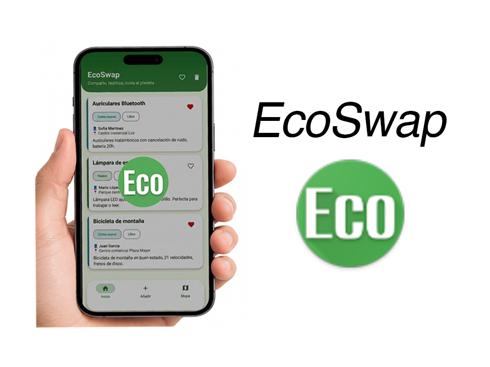
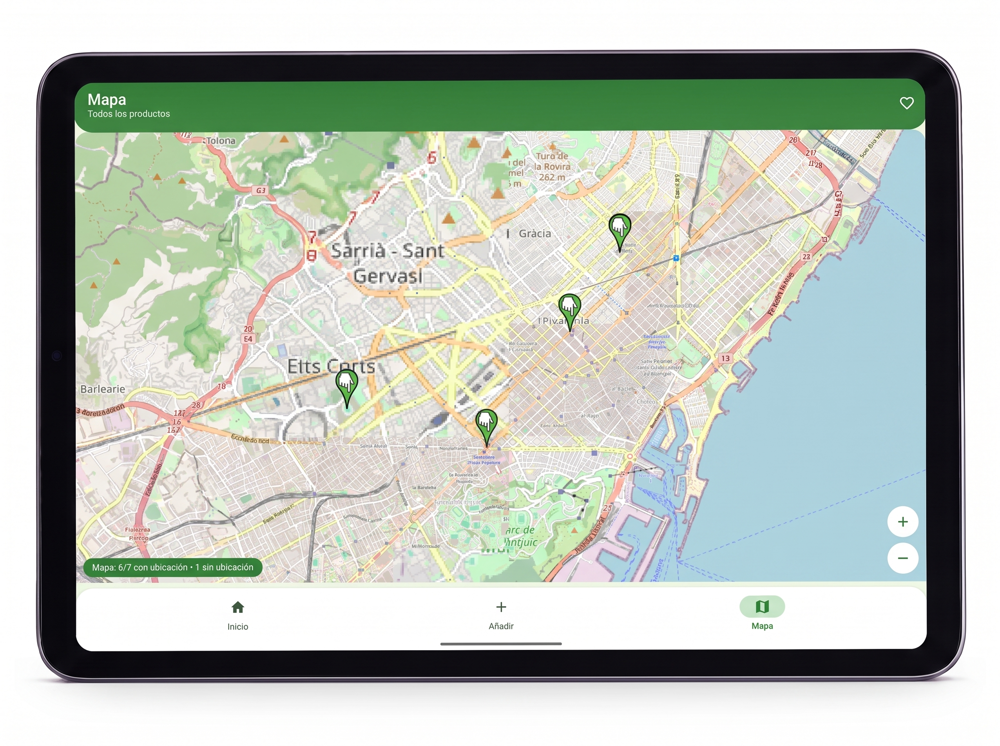

# EcoSwap

<p align="center">
  
</p>

**Comparte, reutiliza, cuida el planeta.** EcoSwap es una aplicación Android para publicar y encontrar objetos de segunda mano que otras personas regalan o intercambian cerca de ti.

<p align="center">
  
</p>

## Funcionalidades

- **Listado de objetos** con su estado (nuevo, como nuevo, usado, mal estado), la persona de contacto y el lugar de recogida.
- **Filtros y ordenación**: filtra por estado o usuario y ordena por recientes, cercanía, título, usuario o estado.
- **Publicación de objetos** mediante un formulario que valida los campos obligatorios. La imagen se toma de la galería o de la **cámara**.
- **Mapa** de OpenStreetMap (osmdroid) con los objetos que tienen ubicación.
- **Favoritos** y una pantalla de detalle para cada objeto.
- **Notificaciones locales** cuando se publica un objeto nuevo.
- **Persistencia local** con Room. La primera vez que se abre la app se cargan unos productos de ejemplo para poder probarla.

## Tecnologías

- Kotlin 2.0 y Jetpack Compose (Material 3)
- Navigation Compose
- ViewModel y corrutinas
- Room con KSP
- osmdroid (mapas de OpenStreetMap)
- Google Play Services Location
- Coil
- AndroidX Core SplashScreen

## Requisitos

- Android Studio con soporte para Android Gradle Plugin 9.0
- JDK 21 para el daemon de Gradle (definido en `gradle/gradle-daemon-jvm.properties`; Gradle puede descargarlo automáticamente)
- Android SDK 36
- Dispositivo o emulador con Android 7.0 (API 24) o superior

## Puesta en marcha

La app no necesita claves de API, cuentas ni ningún otro secreto. Los mapas usan las teselas públicas de OpenStreetMap y los datos se guardan solo en el dispositivo.

1. Clona el repositorio:

   ```bash
   git clone https://github.com/<usuario>/<repositorio>.git
   ```

2. Ábrelo en Android Studio y espera a que termine la sincronización de Gradle. Android Studio crea `local.properties` con la ruta de tu SDK. Si compilas desde la línea de comandos, copia `local.properties.example` a `local.properties` y ajusta `sdk.dir`.
3. Ejecuta la app desde Android Studio, o genera el APK de debug:

   ```bash
   ./gradlew assembleDebug
   ```

   En Windows, usa `gradlew.bat assembleDebug`.

4. Concede los permisos de ubicación, cámara y notificaciones cuando la app los solicite.

## Datos de ejemplo

Los productos precargados son ficticios: los nombres no corresponden a personas reales y las ubicaciones son lugares públicos de Barcelona. El botón de vaciar productos de la cabecera permite borrarlos para empezar desde cero.

## Mapas y OpenStreetMap

Los datos del mapa son © [colaboradores de OpenStreetMap](https://www.openstreetmap.org/copyright) y se distribuyen bajo la licencia ODbL. Si distribuyes la app, cumple la [política de uso de teselas](https://operations.osmfoundation.org/policies/tiles/) de OpenStreetMap. Para un uso intensivo, usa un proveedor de teselas propio o comercial.

## Buenas prácticas de seguridad

- **Firma de release:** el repositorio no incluye configuración de firma. Para publicar, crea tu propio keystore y mantenlo fuera del control de versiones (`*.jks`, `*.keystore` y `keystore.properties` ya están en `.gitignore`).
- **Backend:** si añades un backend como Firebase, usa tu propio `google-services.json` (también ignorado por git). Restringe cada API key por nombre de paquete (`com.example.ecoswap`) y huella SHA-1, define reglas de seguridad restrictivas y activa App Check.
- **Secretos:** no incrustes secretos en el código. Un APK puede descompilarse.

## Licencia

Distribuido bajo la licencia MIT. Consulta el archivo [LICENSE](LICENSE).
